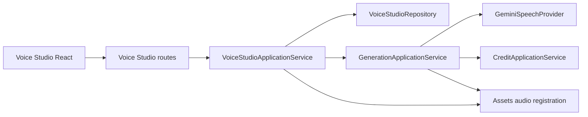

# VS-02 — Source Code และขอบเขตบริการ

Parent: [Basic release](000-master.md). Source implemented; exact paths follow runtime.

Implementation naming reconciliation: `SpeechCatalog.js` owns validated live JSON reads;
`SpeechGenerationService.js` is internal behind GenerationApplicationService speech methods.
Frontend uses VoiceStudioRoute composition, DialogueRowEditor, CharacterVoices,
VoiceManager, TakeCard and VoicePlayback; do not create empty named modules in the table
when these cohesive existing components already own the responsibility.

## 1. เจ้าของและ dependency

Voice Studio เป็นเจ้าของเอกสารบท ตัวละครเสียง และการเลือก/บันทึก Take
Generation เป็นเจ้าของ synthesis, queue, request snapshot, retry และ terminal status
Assets เป็นเจ้าของไฟล์เสียงและ private delivery; Credits เป็นเจ้าของ quote/usage/settlement
Identity และ provider availability ใช้นโยบายเดิม ไม่มี bypass เสียงเพิ่มโดยอัตโนมัติ

Reviewed current entry points: `server/domain/generation/GenerationApplicationService.js`,
`server/providers/GeminiProvider.js`, `server/repositories/assets/AssetRepository.js`,
`server/domain/assets/AssetDeliveryService.js`, `server/config/paths.js`.
Basic speech รองรับผ่าน Generation facade และ queue owner เดิมแล้ว พร้อม audio Assets
และ private Range delivery. Revision 2 ต้องขยาย custom voice operations ผ่าน owners
เหล่านี้ ไม่ส่งเป็น image job ปลอมและไม่สร้างคิวใหม่

## 2. หมวดโค้ดที่เสนอ

| Path | หน้าที่ |
|---|---|
| `web/src/features/voice-studio/routes/VoiceStudioRoute.tsx` | ประกอบหน้าจอและเลือกเอกสาร ไม่คำนวณราคา/ประกอบ provider payload |
| `web/src/features/voice-studio/components/` | DocumentList, DialogueRow, RowInspector, CharacterVoiceDialog, TakeList, AudioPlayer, AudioLibrary |
| `web/src/features/voice-studio/hooks/` | document editing/autosave และ playback sequence; job subscriptions ใช้ owner Generation |
| `web/src/features/voice-studio/api/voiceStudioApi.ts` | เรียกผ่าน shared apiClient เท่านั้น |
| `web/src/features/voice-studio/schemas/voiceStudioSchemas.ts` | Zod boundary ของเอกสาร catalog และ Take summary |
| `web/src/features/voice-studio/model/` | pure row commands, dirty-state/selection และ revision matching |
| `server/app/routes/voiceStudioRoutes.js` | HTTP schema, actorContext และแปลงผล facade |
| `server/domain/voice-studio/VoiceStudioApplicationService.js` | public use cases: documents, presets, request synthesis, select/save Take |
| `server/domain/voice-studio/VoiceStudioDocumentService.js` | validation/revision/row commands; internal ไม่เป็น public pipeline ใหม่ |
| `server/repositories/voice-studio/VoiceStudioRepository.js` | persistence methods แยกตาม entity ผ่าน atomic JSON store |
| `server/domain/generation/SpeechRequestCompiler.js` | pure transcript/style/voice snapshot compiler; ห้ามใช้ image prompt compiler |
| `server/domain/generation/SpeechGenerationService.js` | internal speech operation หลัง GenerationApplicationService facade |
| `server/providers/GeminiSpeechProvider.js` | TTS request/response/usage/error normalization; ไม่เพิ่ม speech branches ลง image GeminiProvider |
| `server/domain/assets/AudioAssetService.js` | validate/register audio bytes และ download metadata ผ่าน Assets |
| `server/config/voice-studio/` | model catalog, voice catalog และ policy ตาม VS-03 |
| `client/i18n/locales/<locale>/voice-studio.json` | namespace ใหม่พร้อม manifest/key parity |

สร้างไฟล์เมื่อมี responsibility จริง ไม่ต้องสร้าง empty scaffolding ทั้งตารางล่วงหน้า
Voice Creator composition ปัจจุบันอยู่ใน VoiceStudioRoute และ Voice Manager อยู่ใน
`components/VoiceManager.tsx`; revision 2 แยก Creator เป็น component เมื่อขอบเขตใหม่
ทำให้ route ใหญ่เกิน responsibility. ใช้ VoicePlayback, Take metadata และ API/schema
ร่วมกัน ไม่ duplicate generation หรือ storage
Manager เรียกคำสั่งจัดการผ่าน facade เดิม; ไม่ให้ route/component เขียนไฟล์เสียงเอง
แยก provider transport ออกจาก business rule; ไม่แยกทุก function เป็นไฟล์
หลีกเลี่ยง `utils`, `manager`, `engine` รวมทุกอย่าง; ใช้ชื่อ domain และ public method ตรงงาน
Export facade เท่าที่ caller ต้องใช้; internal services ไม่ import จาก feature อื่น
เอกสาร README สั้นใน feature/domain อธิบายจุดเริ่มอ่านและวิธีเพิ่ม model ไม่สร้าง framework ใหม่

## 3. HTTP / facade contract ที่เสนอ

ทุก request ใช้ actorContext จาก middleware ไม่รับ ownerId เป็น authority
list ใช้ cursor/limit และ stable ID; mutation ใช้ revision และ idempotency ตามหน้าที่

| Endpoint ภายใต้ `/api/voice-studio` | ผลลัพธ์/เจ้าของ |
|---|---|
| `GET /catalog` | safe model/voice/preset/limit projection ไม่มี secrets |
| `GET, POST /documents` | page of owned documents / create |
| `GET, PATCH /documents/:id` | document / update with expectedRevision; conflict = 409 |
| `POST /documents/:id/archive` | archive แบบย้อนกลับได้; ไม่ลบไฟล์เสียง |
| `GET, POST /characters`; `PATCH /characters/:id` | reusable voice preset / versioned update/archive |
| `POST /documents/:id/rows/:rowId/quotes` | ส่ง snapshot เดียวกับ generation ให้ Credits quote |
| `POST /documents/:id/rows/:rowId/generations` | requestId + expectedRevision + quoteId; Generation admission คืน jobId |
| `GET /documents/:id/rows/:rowId/takes` | paginated completed Take metadata |
| `PUT /documents/:id/rows/:rowId/selected-take` | เลือก Take ที่เป็นของ row/actor; ไม่ซื้อหรือสร้างเสียง |
| `POST /takes/:id/save` | idempotent library pin; snapshot ต้นฉบับไม่เปลี่ยน |
| `GET /audio-library` | owned successful Takes; filter saved/all, document/character/model/tag, cursor/limit และ sort |
| `PATCH /takes/:id` | update display title/tags ด้วย expectedRevision; ห้ามแก้ immutable generation snapshot |
| `DELETE /takes/:id` | ตรวจ owner/reference/revision แล้วประสาน Assets deletion; idempotent retry ไม่ซื้อเสียงใหม่ |

Job reads/events/cancel ใช้ canonical Generation contracts; ไม่เปิด polling endpoint ซ้ำ
Audio retrieval/download ใช้ Assets owner-authorized delivery URL ไม่ส่ง provider URL
endpoint names นี้เป็น proposed surface; implementation ต้องตรวจ route collisions ก่อนเพิ่ม

## 4. Generation lifecycle ที่ต้องเพิ่ม

1. ตรวจ document/row/voice/catalog/actor แล้ว freeze snapshot + request hash
2. Quote และ submit ต้องเป็น snapshot เดียวกัน; เปลี่ยน input แล้ว quote เดิมใช้ไม่ได้
3. Generation admission กัน duplicate requestId; queue/credit ไม่อยู่ใน Voice repository
4. Adapter ส่งบทเป็น transcript และ style เป็น metadata แยกกัน ไม่ต่อ instruction ลงบท
5. Validate audio MIME/container/ขนาด/ความยาว; Assets เขียนไฟล์ครบก่อนประกาศ success
6. Generation เก็บ outputAssetId/usage; Take projection อ้าง job + asset และ input snapshot
7. หากเขียน Take projection ล้มเหลวหลังมี asset แล้ว ให้ reconcile ด้วย jobId ไม่สร้างซ้ำ
8. Failure ไม่มี playable asset ปลอม; sanitize UI error และคง structured operational log

Provider request สำเร็จแต่ client disconnect/cancel ไม่ได้แปลว่า provider ไม่คิดเงิน
ใช้ cancellation/reconciliation ของ Generation; ไม่สัญญา refund จากการกด Stop playback
timeout ที่ผลไม่แน่นอนต้อง reconcile ก่อน retry; error handling ไม่สร้าง paid retry อัตโนมัติ

Delivered settlement recovery: `status: delivered` means the private audio asset already
exists. A failed capture persists `speech_usage_reconciliation_required`,
`speech_usage_exceeds_consent`, or sanitized `speech_settlement_pending` in `errorCode`.
Existing generation-status reads retry idempotent capture using the saved usage and
reservation; they never call CreateVoice for a delivered operation. Successful capture
sets `succeeded` and clears the stale error before Voice Studio projects its candidate.
The UI distinguishes this phase from provider generation and keeps Check status available.

## 5. Maintainability และขอบเขต integration

- API/schema types เป็น boundary เดียว; UI ใช้ catalog capabilities ไม่ตรวจ model ID
- Model compiler และ row commands เป็น pure functions ที่อ่านและทดสอบแยกได้
- TanStack Query keys ใส่ actor identity; เปลี่ยน actor หยุด playback/ล้าง draft cache
- ใช้ canonical polling policy/events; query invalidation เฉพาะเอกสาร/row ที่เปลี่ยน
- ไม่เปลี่ยน Post-Processing, image/video provider, global fonts หรือ Cinematic state
- Audio support เป็น additive contract; regression checks ต้องพิสูจน์ image/video ใช้เดิมได้
- Runtime wiring เพิ่มผ่าน createApp/route registry ตามตำแหน่งเดิม ไม่ขยาย server bootstrap

## 6. Revision 2 — Custom Voice contracts (source implemented; scoped sensitive review passed)

Voice Studio owns actor-scoped custom voice records, names, save/archive selection and
character bindings. Generation owns remote design/create/inspect/delete transport,
operation recovery and immutable provider identifiers; Credits owns any billable design
or audition. Assets owns returned samples. Routes and React never call Google directly.

- Extend VoiceStudioApplicationService and its repository with list/get/save/archive/delete
  custom voice use cases; expose new `/api/voice-studio/custom-voices` endpoints and
  design quote/submission beneath that collection. Implemented endpoints:
  GET/POST `/custom-voices`, POST `/custom-voices/quotes`,
  PATCH/DELETE `/custom-voices/:id`, POST `/custom-voices/:id/save`.
  PATCH accepts expectedRevision and name/displayDescription/archived;
  GET accepts search/saved/archived/cursor/limit and returns items/nextCursor/active operations.
  Status uses existing GET `/generations/:id`; success includes customVoice instead of Take
- Public design submission: description, supported language, display name, model,
  requestId and quoteId. No client-supplied owner or arbitrary provider voice ID
- Admission persists an operation before dispatch; reuse shared queue, actor concurrency,
  status reads and idempotency. Design has its own operation discriminator and rate
  policy; never treat it as a successful dialogue Take or ordinary TTS with guessed cost
- Provider returns voice identity and optional sample. Persist identity immediately;
  validate/register sample via Assets. Sample persistence failure can recover from the
  same voice/operation without creating a second remote voice
- Save pins the completed candidate into My Voices idempotently. Listening, selecting,
  renaming and saving do not dispatch paid generation. User-script audition explicitly
  invokes existing speech synthesis with the resolved custom voice
- UI sends an application-owned voice reference. Server resolves owner, provider project,
  ready state and model compatibility before dispatch; knowing a provider ID gives no access
- Remote deletion checks usages and active operations, persists delete state and retries
  using the same identity. Never list a whole provider project's voices to every actor
- Timeout/unknown remote creation must retain reconciliation state and never blindly
  redispatch. If Google cannot reconcile an ambiguous create, show support recovery;
  do not claim requestId provides provider-side exactly-once guarantees

Frontend remains under `web/src/features/voice-studio/`: route composition, dialogue
editing, voice selection/design and audio library are separate cohesive responsibilities.
Extend existing DialogueRowEditor/CharacterVoices/VoiceManager/VoicePlayback; add focused
components only for event toolbar, inspector, picker and design form. Keep pure caret/
insertion commands in model/, API schemas together, and no provider-specific switches in UI.
Provider protocol code stays in GeminiSpeechProvider or a focused adjacent adapter hidden
behind Generation; no new public pipeline. Tests extend voiceStudio/voiceSpeech runners.

## 7. Revision 3 — Replication contracts (planned, not implemented)

- Extend existing CustomVoiceService/VoiceStudioApplicationService facade; public create
  inputs distinguish `sourceType: text | audio`. Missing discriminator on old requests
  means text. Audio carries actor-owned `sourceAudioAssetId` and `consentAudioAssetId`,
  not arbitrary filesystem paths, remote URLs, Base64 in documents or raw Google IDs.
- Use Assets for private temporary uploads/validated metadata and media access. Routes
  translate multipart input and delegate; check ownership, MIME/header, decoded duration,
  byte limits and upload purpose again on server. Proposed upload endpoints stay under
  `/api/voice-studio/custom-voices/` with Assets as storage owner; finalize exact route and
  existing intake reuse before implementation. No unrestricted media/static route.
- Generation adds operation `voice_replication` to the existing speech operation owner;
  request hash includes immutable validated audio IDs/digests and consent version.
  Extend GeminiSpeechProvider with replicated create/read/delete response handling.
  Shared Queue, concurrency, status, actor isolation and Credits remain authoritative.
- Treat successful remote identity creation separately from optional synthesized preview.
  Persist private remote ID before any further projection. Do not call voiceSample or
  require outputAssetId for replication success. A separate audition failure must not
  discard/recreate the ready voice or alter its source type.
- Audition uses canonical speech synthesis and its own explicit request/quote, output
  Assets and status. Save/rename/list/play do not implicitly synthesize. Keep provider
  identity private in Generation and application customVoiceId in character bindings.
- Creation billing needs a replication-specific qualified policy; absence of design usage
  is neither zero-cost proof nor a reason to apply the prompted-design settlement rules.
  Support documented nonbillable creation only if confirmed; otherwise resolve pricing
  before enabling creation. Existing TTS estimates/reservations/settlement remain intact.
- Recovery reads inspect known identity; unknown remote outcome never blindly replays
  CreateVoice. Consent rejection is distinct from network uncertainty. Error responses
  use safe codes; no raw audio/consent transcript/secret in logs or browser errors.
- Extend existing versioned Zod/API contracts and UI modules; one feature-local upload
  form responsibility, one shared origin badge, no separate Voice Studio/provider store.
